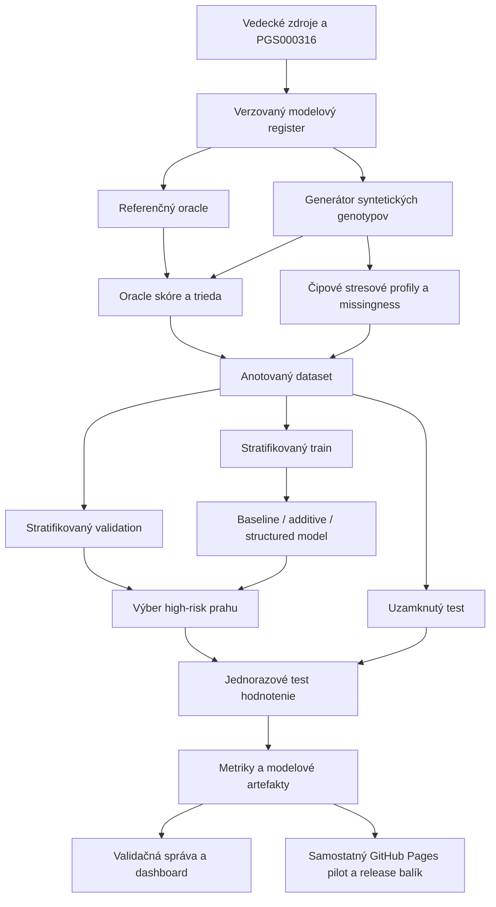

# Procesná mapa celiakálneho pilotu

## Riadený dátový tok

## Kontrolné brány

1. **Evidence gate:** každý marker má efektovú alelu, váhu, populáciu a zdroj.
2. **Data gate:** generátor je deterministický pri rovnakom seede a množiny sa neprekrývajú.
3. **Leakage gate:** prah sa vyberá iba na `validation`, nie na `test`.
4. **Performance gate:** reportujú sa všetky požadované metriky vrátane false-negative rate.
5. **Interpretation gate:** syntetická fidelity sa nesmie označiť za klinickú validáciu.
6. **Release gate:** model, manifest, dataset card, metriky a dokumentácia majú spoločnú verziu a kontrolné súčty.

Produkčné prepojenie s externou obrazovou platformou je zámerne vynechané z tejto etapy. Verejným cieľom je samostatný auditovateľný GitHub Pages pilot.

